# config-drift-checker

**CI for your coding agent's instructions.** Your `CLAUDE.md`, skills and hooks now decide how
your code gets written, and nothing tests them. Claude Code ships about 25 releases a month, the
model behind an alias changes without a changelog, and a teammate's one-line edit to a skill can
switch it off. You find out weeks later, from the code.

config-drift-checker turns those instructions into eval cases and runs them on every pull request
and every Claude Code release, against a pinned baseline. When something stops working, you get a
red check that says what broke, why, and what moved, and it can propose the fix.

[](https://github.com/jameskomo/config-drift-checker/actions/workflows/test.yml)
[](https://github.com/jameskomo/config-drift-checker/releases)
[](https://jameskomo.github.io/config-drift-checker/drift/)



## What it found when we ran it on ourselves

We run it on our own Claude Code setup every day, in public. Four things it caught that nothing
else would have:

- **A one-line PR silently switched off a skill.** We rewrote a skill's trigger description the
  way a careless PR would. The suite fell from 1.00 to 0.56, and the report named the cause by
  itself: the skill was *discovered but never invoked*, so fix the wording, not the packaging. The
  repair skill then fixed it and proved it with a green re-run, for $0.28.
  [The report](https://jameskomo.github.io/config-drift-checker/example-break/report.html) ·
  [the repair](docs/example-break/repair-summary.md)
- **Claude Code 2.1.310 stopped running shell-based evals on GitHub's Ubuntu runners**, because
  of a sandbox check. Our release canary caught it the day it shipped; the Action now handles it.
- **Our own tests were weaker than they looked.** We sabotaged our setup 15 ways on purpose. The
  suite caught 6. Some rules made no difference at all, because the model follows them anyway.
  [The mutation report](https://jameskomo.github.io/config-drift-checker/mutation/report.html)
- **Our skill fires on 30% of prompts it should ignore**, and misses 29% it should take. One
  passing test had been saying "works".
  [The trigger map](https://jameskomo.github.io/config-drift-checker/triggers/report.html)

## Try it

**In 30 seconds, nothing to install.** Two free checks on any Claude Code plugin or skills
folder. Each is one dependency-free file (read it first, it's short), and neither runs a model:

```bash
curl -fsSLO https://raw.githubusercontent.com/jameskomo/config-drift-checker/v1/config-drift-checker/tools/skill-lint.mjs && node skill-lint.mjs .      # broken or vague SKILL.md files
curl -fsSLO https://raw.githubusercontent.com/jameskomo/config-drift-checker/v1/config-drift-checker/tools/suite-doctor.mjs && node suite-doctor.mjs .  # eval cases your Claude Code will reject; --fix
```

**In about 10 minutes, the whole thing.** In the repo you want protected:

```bash
claude plugin marketplace add jameskomo/config-drift-checker && claude plugin install config-drift-checker@jameskomo && claude "/config-drift-checker:setup"
```

It reads your CLAUDE.md, skills and hooks, writes starter eval cases from them, runs them once,
and writes the GitHub workflow. Add one secret (`CLAUDE_CODE_OAUTH_TOKEN` from
`claude setup-token` runs on your Pro or Max plan at no extra cost; or `ANTHROPIC_API_KEY`) and
push. No Claude session handy? `node <plugin-root>/tools/cdc-bootstrap.mjs .` does the same from a
plain terminal, and `--no-agent` scaffolds everything for $0.

**Already have `claude plugin eval` cases?** One step in your workflow:

```yaml
- uses: jameskomo/config-drift-checker/action@v1
  with: { plugin-dir: . }
```

## What it answers

| Your question | What does it | Live example |
|---|---|---|
| **Did my setup stop working?** | Every PR and every Claude Code release runs your suite against a pinned baseline. Noise bands learned from history keep flaky cases amber and real breaks red. Releases the budget skipped show as *untested*, never as green | [our observatory](https://jameskomo.github.io/config-drift-checker/drift/) |
| **Why did it break?** | The report says whether a skill was never invoked (wording) or never found (packaging), whether the model refused, and whether Claude Code or the model moved since the baseline | [a real break](https://jameskomo.github.io/config-drift-checker/example-break/report.html) |
| **Which release broke it?** | `drift-bisect` searches the releases in between and names the first bad one in log2(N) runs | [guide](docs/user-guide.md#which-release-broke-it-drift-bisect) |
| **How do I fix it?** | On red, the repair skill makes the smallest edit to your setup that restores the behaviour, proves it with a re-run, and opens a PR. Never auto-merged | [a real repair](docs/example-break/repair-summary.md) |
| **Would my tests even catch a break?** | `mutate` sabotages copies of your setup and scores how many breaks the suite catches | [ours: 6 of 15](https://jameskomo.github.io/config-drift-checker/mutation/report.html) |
| **Does my skill fire when it should?** | `trigger-map` measures fire and false-fire rates with 95% ranges, and which skills steal each other's prompts | [ours](https://jameskomo.github.io/config-drift-checker/triggers/report.html) |
| **Does the suite test what people actually do?** | `usage-check` compares your eval cases with your real sessions; `case-miner` turns real prompts into suggested cases, anonymised on your machine | [guide](docs/user-guide.md#real-usage-vs-evals-is-your-suite-testing-what-people-do) |
| **Which model or version can I move to?** | `drift-matrix` runs the suite across models and Claude Code versions on one page, with a plain verdict per model | [ours: Sonnet holds, Haiku misses one case](https://jameskomo.github.io/config-drift-checker/matrix/report.html) |
| **What does this PR change?** | A PR comment: tokens it adds to every session, the rules it changes, the cases that test them, and changed rules nothing tests | [guide](docs/user-guide.md#4-adding-the-check-to-an-existing-pipeline-no-claude-code-needed) |
| **What changed inside Claude Code?** | Every release, a free word-by-word diff of the instructions in Claude Code's built-in tools, and a check of every public eval suite we can find | [release report](https://jameskomo.github.io/config-drift-checker/release-report/) |
| **Do my rules work in Codex or Gemini?** | The same cases run through both CLIs. Rules carry over; Claude Code hooks don't run there | [Claude 1.00, Gemini 0.77, Codex 0.63](https://jameskomo.github.io/config-drift-checker/agents/) |

Every one of these is in the [user guide](docs/user-guide.md), with the commands.

## How it compares with `claude plugin eval`

Claude Code's built-in eval runner is good, and we build on it: same case format, and the Action
uses it whenever your Claude Code has it. It answers *"does my plugin work right now?"*. This
answers *"did anything stop working since it last did, on any release, without me watching?"*

| | `claude plugin eval` | config-drift-checker |
|---|---|---|
| Run cases, grade, report one run | yes | uses it |
| Baseline to compare against, history across releases | no | yes |
| Runs on every Claude Code release, on its own | no | release watch and canary |
| Flake or real break | a 2-of-3 judge vote per run | noise bands from history, confidence ranges |
| Why a case failed | a score | the cause, and a proposed fix |
| Are the tests any good | no | mutation testing, trigger rates |
| PR check, PR comment, Slack, budget caps | exit code, per-run cost cap | all of them |
| Codex and Gemini | no | yes |

## Free, private, yours

It runs on your CI runner with your key. There is no server of ours, so nothing is sent to us.
Zero npm dependencies, 325 tests that run against a fake `claude`, every third-party action pinned
to a commit, CodeQL on every push. The `v1` tag never breaks your workflow; breaking changes get a
new major and an upgrade note. Spend is capped per run and per month from a ledger, and on a
Pro or Max token it costs no API credit at all. Details: [security](docs/security.md),
[privacy](PRIVACY.md).

A managed tier (we run the canaries and dashboards, you get the PRs) gets built when enough teams
want it: [join the waitlist](https://github.com/jameskomo/config-drift-checker/issues/new?template=hosted-waitlist.yml).
Questions and ideas: [Discussions](https://github.com/jameskomo/config-drift-checker/discussions).

**Docs:** [user guide](docs/user-guide.md) · [`.cdc.yml` reference](docs/user-guide.md#cdcyml) ·
[architecture](docs/architecture.md) · [eval format](docs/eval-format-and-runner.md) ·
[runbook](docs/runbook.md) · [changelog](CHANGELOG.md) · [demo repo](https://github.com/jameskomo/config-drift-checker-demo)

**Licence:** [FSL-1.1-Apache-2.0](LICENSE). Free to use, modify and self-host; not to be offered
as a competing commercial service; each release becomes Apache-2.0 two years after publication.
